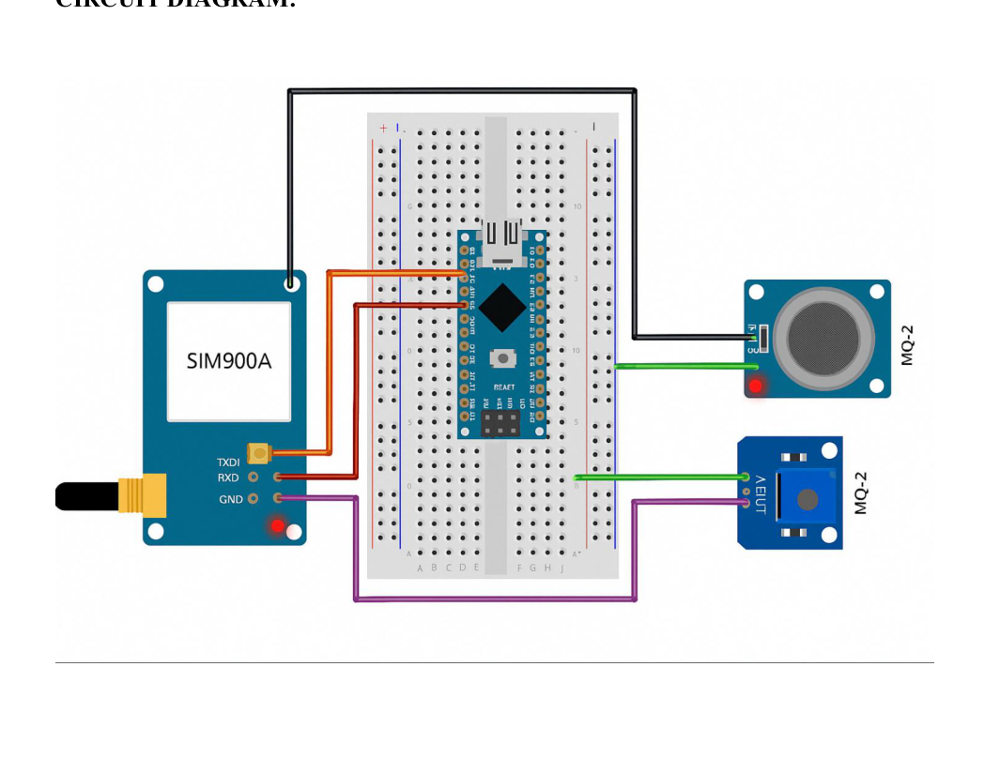

# Arduino GSM Based LPG Leakage Detector

An Arduino Nano-based project that detects LPG leakage using an MQ-6 gas sensor and alerts the user by making a phone call through a SIM900A GSM module.

## Components Used

- Arduino Nano
- MQ-6 Gas Sensor
- SIM900A GSM Module
- Breadboard
- Jumper wires
- External 5V 2A power supply

## Working

1. The MQ-6 sensor monitors the surrounding air for LPG.
2. The sensor sends a digital signal to the Arduino Nano.
3. When the gas level crosses the set threshold, the Arduino detects the signal.
4. The Arduino sends AT commands to the SIM900A module.
5. The GSM module makes a call to the predefined phone number.

## Circuit Diagram

## Source Code

The Arduino code is available in `src/lpg_leakage_detector.ino`.

Before uploading, replace the placeholder phone number in the code with the alert number. Check the sensor's output polarity and module connections before testing.

## Project Report

The complete project report is available in `docs/project_report.pdf`.

## Applications

- Home kitchens
- Restaurants and hotels
- Gas storage areas
- Commercial buildings

## Note

This is an academic prototype and should not be used as the only safety system for detecting LPG leaks. Verify the sensor model, wiring, and operation before use.
